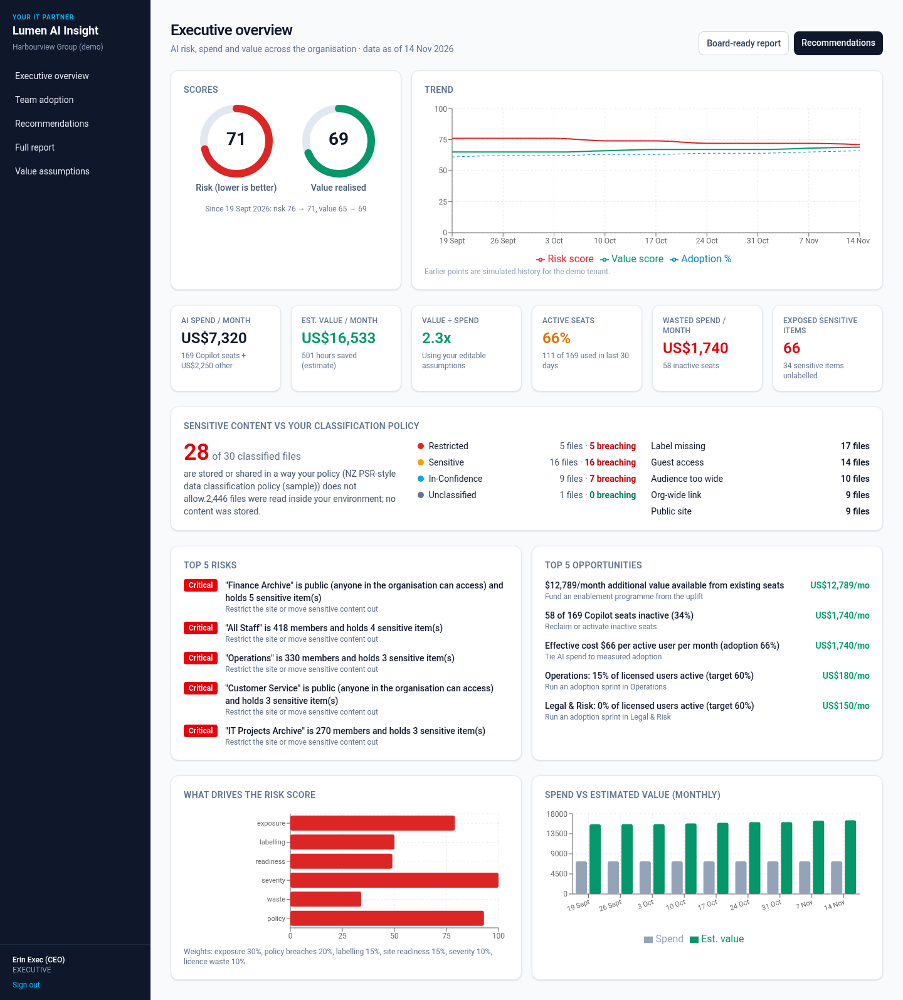
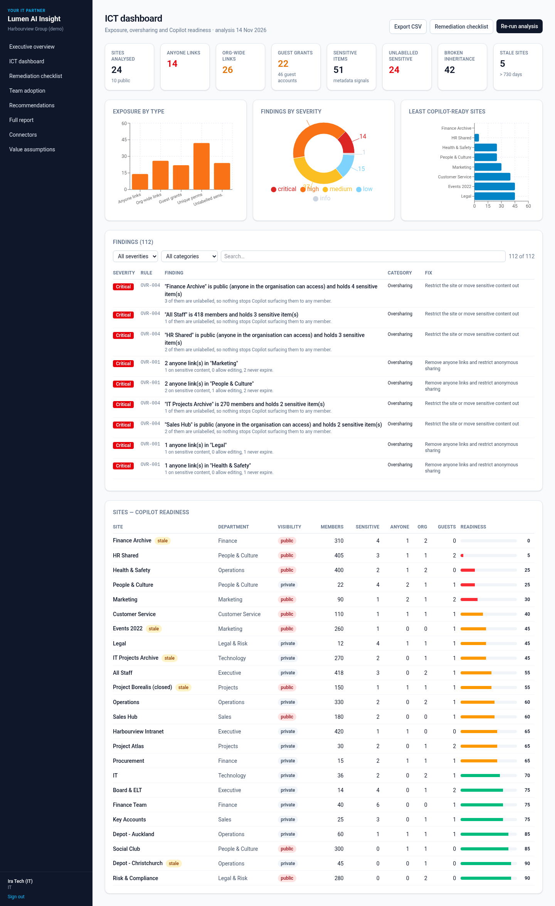
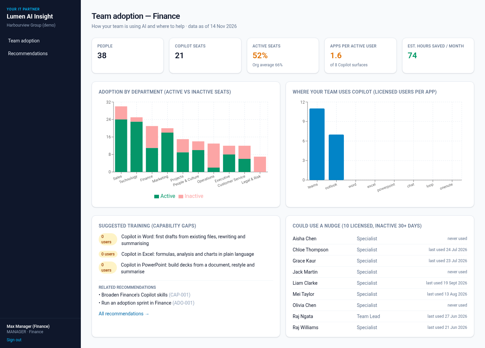
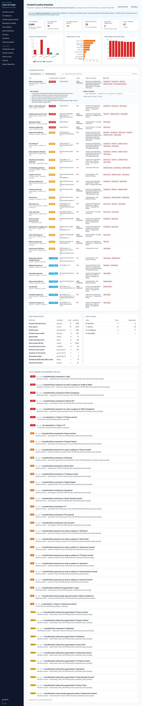
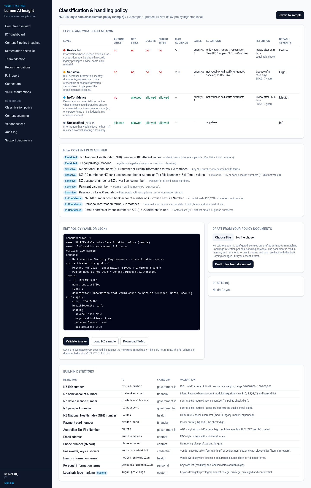
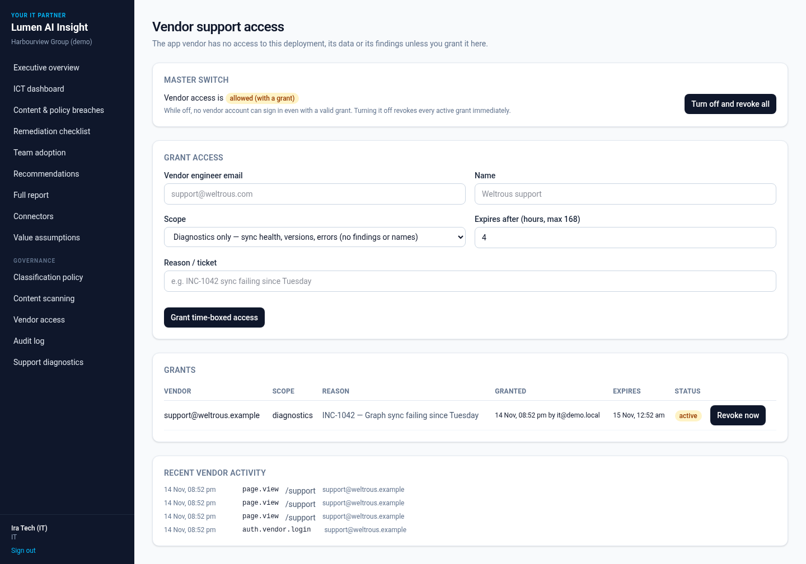

# Lumen AI Insight (working name)

**AI visibility & value platform.** Connects to an organisation's AI estate and its content
platforms, then shows IT, executives and managers:

- **Content vs policy** — reads file content **inside the client's environment** (never stored),
  detects personal, financial, health and credential data with validated detectors (IRD, NZ bank,
  NHI, passport, driver licence, cards, TFN, secrets…), classifies each file against the
  organisation's own classification policy (NZ PSR-style sample included), and reports every file
  that is shared, labelled, stored or retained in breach of it — with evidence and a fix.
- **Exposure & risk** — oversharing (anyone / org-wide links, guests, public sites, broken
  inheritance, stale content), unlabelled sensitive content, dormant access, and a per-site
  **Copilot readiness** score.
- **Spend & waste** — paid seats vs. active use, cost per active user, consumption costs.
- **Value** — estimated hours and money saved, with **editable, visible assumptions**.
- **Recommendations** — every finding comes with concrete, ordered fix steps, a remediation
  checklist for IT, and training suggestions for managers.

> The product name is a placeholder defined once in [`packages/core/src/brand.ts`](packages/core/src/brand.ts)
> (or via `NEXT_PUBLIC_PRODUCT_NAME` / `NEXT_PUBLIC_VENDOR_NAME`), so it can be rebranded or white-labelled.

| Executive                                                 | ICT                                           | Manager                                               |
| --------------------------------------------------------- | --------------------------------------------- | ----------------------------------------------------- |
|  |  |  |

| Content & policy breaches                                    | Classification policy                                    | Vendor access (client-controlled)                       |
| ------------------------------------------------------------ | -------------------------------------------------------- | ------------------------------------------------------- |
|  |  |  |

More: [site drill-down](docs/screenshots/03-ict-site-drilldown.png) ·
[remediation checklist](docs/screenshots/04-ict-remediation-checklist.png) ·
[recommendations](docs/screenshots/06-recommendations.png) · [report](docs/screenshots/07-report.png)
([sample PDF](docs/screenshots/sample-report.pdf)) · [connectors](docs/screenshots/08-connectors.png) ·
[assumptions](docs/screenshots/09-assumptions.png) · [content scanning](docs/screenshots/12-content-scanning.png) ·
[audit log](docs/screenshots/14-audit-log.png) · [support diagnostics](docs/screenshots/15-support-diagnostics.png)

## Privacy model in one paragraph

The app is **installed in the client's environment** (Docker Compose on-prem or the Bicep template in
their Azure subscription). The worker downloads files from Microsoft Graph **into memory**, extracts
text, runs the detectors and discards the bytes; only detector names, counts, keyed hashes and (if
the client turns it on) short redacted snippets are stored. Optional LLM classification only talks to
the client's own Azure OpenAI or local model. Nothing is sent to the vendor (telemetry is opt-in,
anonymised counts). The vendor can only sign in if the client's admin grants a scoped, time-boxed,
audited support login. See [SECURITY.md](docs/SECURITY.md) and [VENDOR_ACCESS.md](docs/VENDOR_ACCESS.md).

## Pilot scope (v0.1)

| Source                                                                                                                             | Status                                                             |
| ---------------------------------------------------------------------------------------------------------------------------------- | ------------------------------------------------------------------ |
| Microsoft 365 — SharePoint / OneDrive exposure, sensitivity labels, M365 Copilot usage & licences (Microsoft Graph, read-only)     | **Available**                                                      |
| SharePoint / OneDrive **file content** classification vs the client's policy (docx, xlsx, pptx, pdf, txt, csv, md, eml, msg, html) | **Available** (in-memory, client-hosted)                           |
| Demo organisation (synthetic data, no credentials)                                                                                 | **Available**                                                      |
| ChatGPT Enterprise, Claude (Anthropic), Google Gemini, custom AI / LMS via webhook & OpenTelemetry                                 | Planned (interface + TODO docs in `packages/connectors/src/stubs`) |

## Quick start

### Option A — Docker Compose (Postgres, recommended)

```bash
cp .env.example .env
# set NEXTAUTH_SECRET (openssl rand -base64 32)
docker compose up --build
```

Open http://localhost:3000 and sign in with a demo account (password `demo1234`, or `DEMO_PASSWORD`):

| Email                | Role              | Lands on                                  |
| -------------------- | ----------------- | ----------------------------------------- |
| `it@demo.local`      | IT / ICT          | ICT dashboard (everything)                |
| `exec@demo.local`    | Executive         | Executive overview, report, manager views |
| `manager@demo.local` | Manager (Finance) | Team adoption, recommendations            |

### Option B — local Node (no Docker)

Requires Node 22+.

```bash
npm install
cp .env.example .env
# For SQLite (zero setup) set an ABSOLUTE path, e.g.:
#   DATABASE_URL="file:$PWD/packages/db/prisma/dev.db"
# or point DATABASE_URL at any Postgres.
npm run db:generate      # picks provider from DATABASE_URL (postgresql:// or file:)
npm run db:push          # create tables
npm run db:seed          # demo tenant + 8 weeks of simulated trend history
npm run dev              # http://localhost:3000
```

> Switching between SQLite and Postgres? Re-run `npm run db:generate` after changing `DATABASE_URL`.

### Everyday commands

```bash
npm run lint         # ESLint (whole monorepo)
npm run typecheck    # tsc --noEmit in every workspace
npm test             # Vitest unit tests (rules, validators, extraction, policy, redaction, Graph parsing…)
npm run build        # Next.js production build
npm run worker -- sync-all              # sync every connector + re-analyse
npm run worker -- policy-import --tenant <slug> --file policy.yaml
npm run screenshots  # BASE_URL=... CHROME_PATH=... — refresh docs/screenshots
```

## Running a real pilot

Deploy into the client's environment with **[docs/DEPLOYMENT.md](docs/DEPLOYMENT.md)** (Docker Compose
on-prem, or `deploy/azure/main.bicep`). Then follow **[docs/PILOT_SETUP.md](docs/PILOT_SETUP.md)** — a step-by-step guide for the client's IT admin to create a
read-only Entra app registration, plus the commands to onboard the tenant:

```bash
npm run worker -- create-tenant --name "Client Ltd" --slug client --admin-email it@client.com --admin-password '<12+ chars>'
npm run worker -- check --tenant client     # verifies credentials & permissions
npm run worker -- sync --tenant client      # first sync + analysis
```

## Repository layout

```
apps/
  web/            Next.js (App Router) UI, auth, server actions, API routes
  worker/         CLI + scheduler: seed, onboard tenants, sync, analyse
packages/
  core/           brand, roles, normalized domain model (zod), content-scan types, assumptions
  connectors/     Connector interface + Microsoft Graph (incl. content download), demo, planned stubs
  policy/         Classification policy schema, YAML import/export, evaluation, NZ sample, drafting
  content-scan/   Validators, detectors, text extraction, redaction, scanner, client-only LLM adapter
  analysis/       Rule engine, 20 documented rules (incl. policy breaches), scoring (pure, deterministic)
  db/             Prisma schema (Postgres / SQLite), persistence helpers
  pipeline/       Orchestration used by worker + web: sync → persist → analyse → store
deploy/azure/     Bicep: Container Apps + private PostgreSQL + Key Vault in the client's subscription
docs/             Architecture, deployment, pilot setup, policy guide, security, vendor access, screenshots
```

## Documentation

- [docs/ARCHITECTURE.md](docs/ARCHITECTURE.md) — design, data flow, decisions
- [docs/PILOT_SETUP.md](docs/PILOT_SETUP.md) — client IT admin guide (Entra app registration, permissions)
- [docs/DEPLOYMENT.md](docs/DEPLOYMENT.md) — client-hosted deployment (Docker Compose, Azure Bicep)
- [docs/SECURITY.md](docs/SECURITY.md) — content handling, LLM, telemetry, least privilege, secrets
- [docs/VENDOR_ACCESS.md](docs/VENDOR_ACCESS.md) — zero vendor access; time-boxed support grants
- [docs/POLICY_GUIDE.md](docs/POLICY_GUIDE.md) — classification policy format, detectors, drafting
- [docs/ADDING_A_CONNECTOR.md](docs/ADDING_A_CONNECTOR.md)
- [docs/ADDING_AN_ANALYSIS_RULE.md](docs/ADDING_AN_ANALYSIS_RULE.md)
- [AGENTS.md](AGENTS.md) — conventions for AI coding assistants (and humans)

## Deployment options

**Client-hosted single-tenant is the primary mode**: Docker Compose on the client's server, or the
Bicep template in the client's Azure subscription. The code still keeps `tenantId` on every row, so a
vendor-hosted multi-tenant deployment remains possible for demos or metadata-only pilots.

## Known gaps (v0.1)

See the "Roadmap / known gaps" section of [docs/ARCHITECTURE.md](docs/ARCHITECTURE.md#roadmap--known-gaps).
